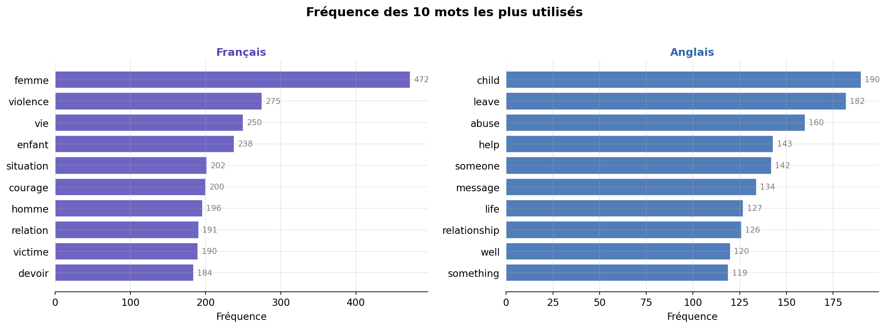
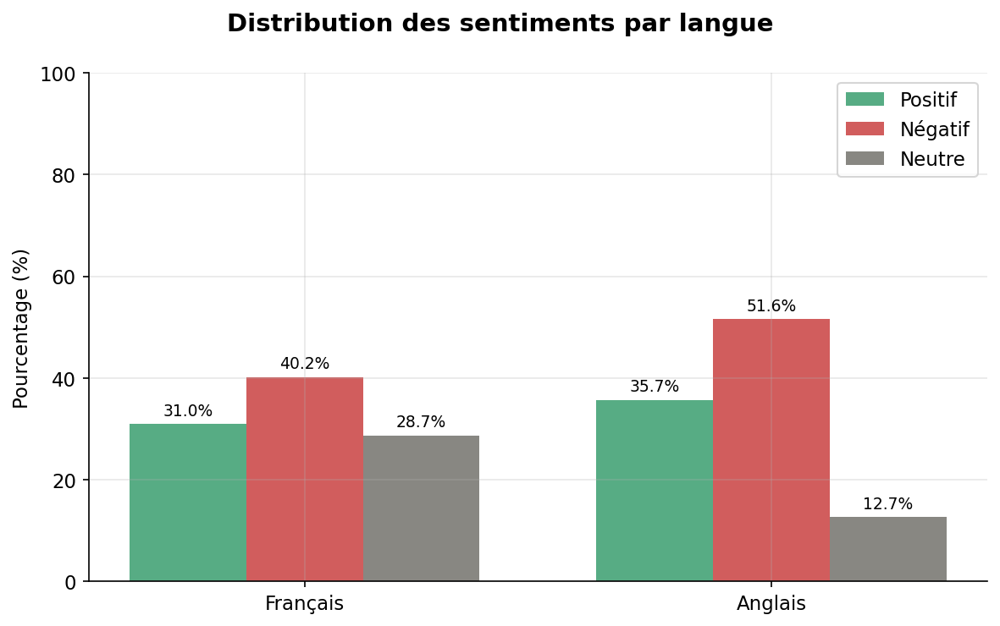
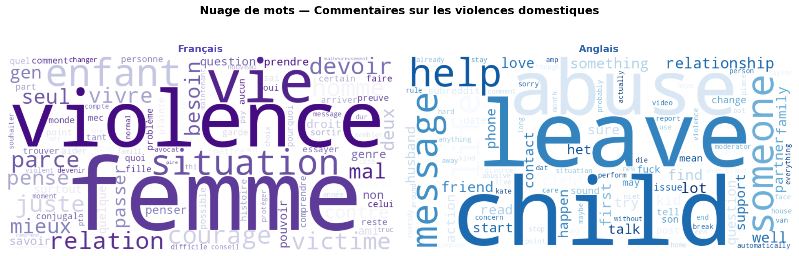
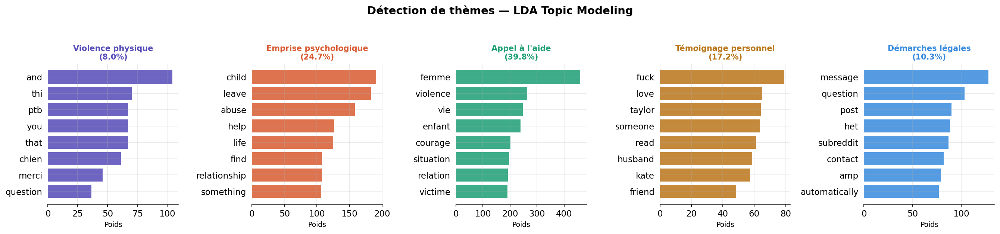
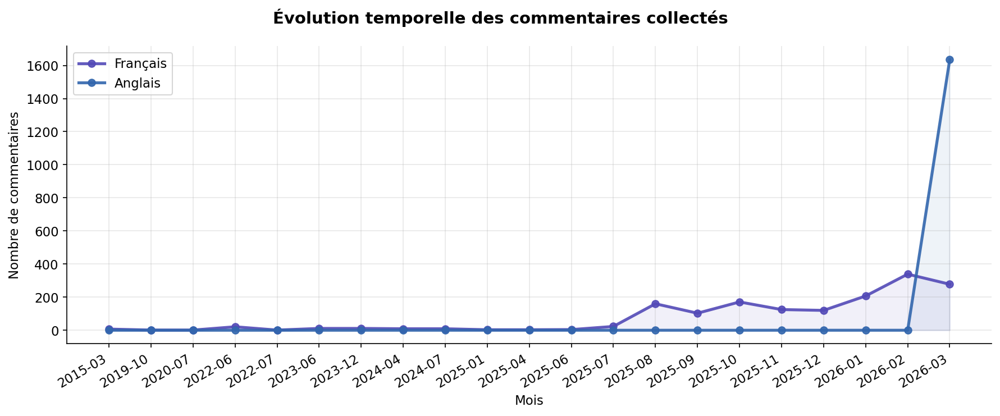

<p align="center">
  <h1 align="center">🔍 Text Mining — Violences Domestiques envers les Femmes</h1>
  <p align="center">
    <em>Analyse NLP de commentaires Reddit sur les violences conjugales — Projet universitaire</em>
  </p>
  <p align="center">
    
    
    
    
  </p>
</p>

---

## 📋 Sommaire

- [Présentation du projet](#-présentation-du-projet)
- [Pipeline de données](#-pipeline-de-données)
- [Technologies utilisées](#-technologies-utilisées)
- [Structure du projet](#-structure-du-projet)
- [Résultats et visualisations](#-résultats-et-visualisations)
- [Installation et exécution](#-installation-et-exécution)
- [Méthodologie détaillée](#-méthodologie-détaillée)
- [Auteure](#-auteure)

---

## 🎯 Présentation du projet

Ce projet de **Text Mining** explore la thématique des **violences domestiques envers les femmes** à travers l'analyse de commentaires collectés sur **Reddit**, en **français** et en **anglais**.

L'objectif est d'appliquer un pipeline NLP complet — du scraping à la visualisation — pour extraire des **insights** sur la manière dont les internautes discutent de ce sujet sensible sur les réseaux sociaux.

### Chiffres clés

| Métrique | Valeur |
|---|---|
| 💬 Commentaires collectés | **~12 500** |
| 🇫🇷 Commentaires en français | ~7 360 |
| 🇬🇧 Commentaires en anglais | ~5 150 |
| 🔑 Mots-clés de recherche | 12 (6 FR + 6 EN) |
| 📅 Période couverte | 2015 — 2026 |

---

## ⚙️ Pipeline de données

```
┌──────────────┐     ┌──────────────┐     ┌──────────────────┐     ┌──────────────────┐
│   SCRAPING   │────▶│  NETTOYAGE   │────▶│  PRÉTRAITEMENT   │────▶│    ANALYSE &     │
│  Reddit API  │     │  Texte brut  │     │    NLP (spaCy)   │     │  VISUALISATION   │
└──────────────┘     └──────────────┘     └──────────────────┘     └──────────────────┘
     .py                  .ipynb               .ipynb                   .ipynb
```

---

## 🛠️ Technologies utilisées

| Catégorie | Outils |
|---|---|
| **Langage** | Python 3.10+ |
| **Scraping** | `requests`, Reddit JSON API |
| **Nettoyage** | `pandas`, `regex` |
| **NLP / Prétraitement** | `spaCy` (fr + en), `NLTK` (tokenisation, stopwords, stemming) |
| **Analyse de sentiments** | 🤗 `transformers` — modèle `BERT multilingue` |
| **Topic Modeling** | `scikit-learn` — `LDA` (Latent Dirichlet Allocation) |
| **Visualisation** | `matplotlib`, `seaborn`, `WordCloud` |
| **Environnement** | Jupyter Notebook |

---

## 📁 Structure du projet

```
violences-domestiques/
│
├── 📄 README.md                        # Ce fichier
├── 📄 .gitignore                       # Fichiers ignorés par Git
│
├── 🕷️ scraping-reddit.py               # Script de collecte des commentaires Reddit
├── 📓 text-mining.ipynb                 # Notebook principal (nettoyage + prétraitement + analyse)
│
├── 📂 nettoyage/                        # Données après nettoyage
│   ├── reddit_commentaires_nettoyes.csv
│   ├── reddit_nettoyes_fr.csv
│   └── reddit_nettoyes_en.csv
│
├── 📂 preprocessed/                     # Données après prétraitement NLP
│   └── reddit_commentaires_preprocessed.csv
│
├── 📂 vizualisation/                    # Graphiques générés
│   ├── viz1_frequence_mots.png
│   ├── viz2_sentiments.png
│   ├── viz3_wordcloud.png
│   ├── viz4_lda_topics.png
│   └── viz5_evolution_temporelle.png
│
├── 📂 captures-scraping/               # Captures d'écran du scraping
│   ├── scrapin 1.png
│   └── scraping2.png
│
└── 📂 données brutes (non versionnées)
    ├── reddit_commentaires.csv
    ├── reddit_commentaires_en.csv
    └── reddit_commentaires_fr.csv
```

---

## 📊 Résultats et visualisations

### 1. Fréquence des mots les plus utilisés

Les mots les plus fréquents révèlent les thèmes centraux des discussions :
- 🇫🇷 **Français** : *femme* (472), *violence* (275), *vie* (250), *enfant* (238)
- 🇬🇧 **Anglais** : *child* (190), *leave* (182), *abuse* (160), *help* (143)

<p align="center">
  
</p>

### 2. Analyse de sentiments (BERT multilingue)

Distribution des sentiments détectés par le modèle BERT :
- Les commentaires en **anglais** sont plus polarisés (51.6% négatif)
- Les commentaires en **français** montrent une répartition plus équilibrée

<p align="center">
  
</p>

### 3. Nuage de mots (WordCloud)

Représentation visuelle des termes les plus utilisés dans chaque langue :

<p align="center">
  
</p>

### 4. Topic Modeling — LDA

5 thèmes principaux identifiés automatiquement par l'algorithme LDA :

| # | Thème | Proportion |
|---|---|---|
| 1 | 🟣 Violence physique | 8.0% |
| 2 | 🟠 Emprise psychologique | 24.7% |
| 3 | 🟢 Appel à l'aide | **39.8%** |
| 4 | 🟤 Témoignage personnel | 17.2% |
| 5 | 🔵 Démarches légales | 10.3% |

<p align="center">
  
</p>

### 5. Évolution temporelle

Volume de commentaires collectés au fil du temps, par langue :

<p align="center">
  
</p>

---

## 🚀 Installation et exécution

### Prérequis

- Python 3.10 ou supérieur
- pip

### Installation

```bash
# Cloner le repository
git clone https://github.com/Nafissatou172/violences-domestiques.git
cd violences-domestiques

# Créer un environnement virtuel
python -m venv venv
source venv/bin/activate  # macOS/Linux

# Installer les dépendances
pip install pandas spacy nltk matplotlib seaborn wordcloud scikit-learn transformers torch

# Télécharger les modèles de langue spaCy
python -m spacy download fr_core_news_sm
python -m spacy download en_core_web_sm
```

### Exécution

```bash
# 1. Lancer le scraping (optionnel — les données sont déjà fournies)
python scraping-reddit.py

# 2. Ouvrir le notebook d'analyse
jupyter notebook text-mining.ipynb
```

---

## 🔬 Méthodologie détaillée

### Partie 1 — Scraping Reddit

Le script [`scraping-reddit.py`](scraping-reddit.py) collecte des commentaires via l'API JSON publique de Reddit en utilisant **12 mots-clés** bilingues :

| 🇫🇷 Français | 🇬🇧 Anglais |
|---|---|
| femme battue | battered woman |
| violence conjugale | domestic violence woman |
| emprise conjugale | coercive control partner |
| conjoint violent | abusive husband |
| fuir conjoint violent | leaving abusive partner |
| féminicide | femicide |

Le script intègre une gestion avancée du **rate limiting** (pauses aléatoires, retry sur erreur 429) pour respecter les limites de l'API.

### Partie 2 — Nettoyage & Prétraitement NLP

Pipeline de traitement appliqué dans [`text-mining.ipynb`](text-mining.ipynb) :

1. **Nettoyage** — Suppression des URLs, emojis, caractères spéciaux, normalisation
2. **Tokenisation** — Découpage en mots avec NLTK (filtrage alphabétique, 3-15 caractères)
3. **Suppression des stopwords** — Listes NLTK + mots vides personnalisés (FR + EN)
4. **Lemmatisation** — Réduction à la forme canonique avec spaCy (`marchait` → `marcher`)
5. **Stemming** — Réduction à la racine avec SnowballStemmer (`violences` → `violen`)

### Partie 3 — Analyse & Visualisation

- **Fréquence des mots** — Top 10 par langue (Counter + matplotlib)
- **Analyse de sentiments** — BERT multilingue (`nlptown/bert-base-multilingual-uncased-sentiment`)
- **Nuage de mots** — WordCloud bilingue avec palettes de couleurs distinctes
- **Topic Modeling** — LDA avec 5 topics via scikit-learn
- **Évolution temporelle** — Série chronologique des commentaires par mois

---

## 👩‍💻 Auteure

**Nafissatou** — Projet universitaire de Text Mining

---

<p align="center">
  <em>⭐ Si ce projet vous intéresse, n'hésitez pas à laisser une étoile !</em>
</p>
